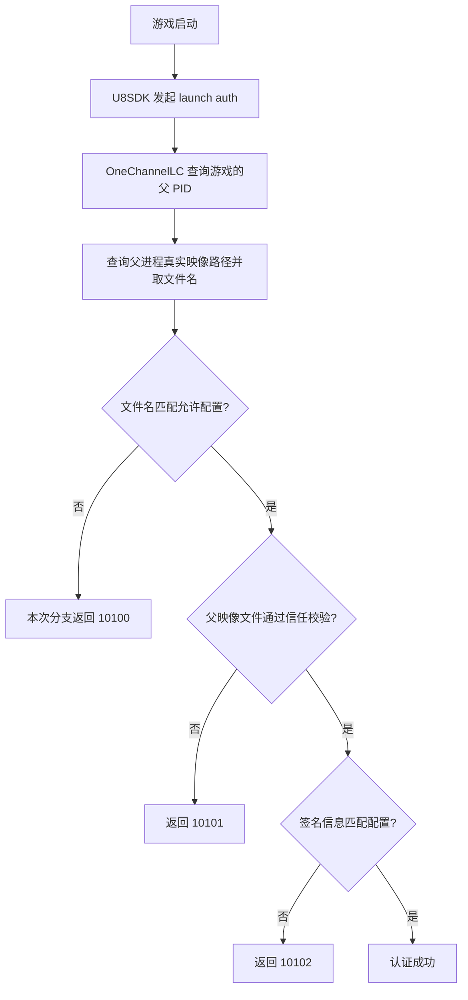

# Endfield 独立启动工具：实现原理与流程

0.3.1 支持 `language` 切换默认显示语言，`language cn` / `language en` 指定并保存；即时切换后续日志、帮助、状态及提示，下次启动沿用。首次默认为英文，设置位于 Rust EXE 旁的 `launcher-settings.json`，与游戏启动参数 `--lang` 独立。

记录日期：2026-10-16。项目目录：`D:\Project\zmd`。实现语言：Rust；初版使用标准库与 Win32 FFI，0.2.0 增加 JSON、ZIP、哈希和 Windows API 绑定依赖。

当前交互已更新：无参数运行按已保存的显示语言输出日志、检查并启动游戏，创建进程后进入 `endfield> ` 命令终端，保留控制台启动日志；输入命令后按 Enter 执行，`cn` 批量显示此前日志的中文翻译，后续使用当前默认语言。输入时显示候选，Tab / Shift+Tab 向前/向后循环补全，上下键调用历史，Ctrl+Z 关闭自有游戏并保留终端。已修复鼠标事件被消费导致滚轮失效的问题。详情及本轮验证见 [终端说明](analysis/menu-control.md)。

**0.2.0 更新：** 启动前现在由 Rust 内置查询/下载/提取与签名/版本验证；默认运行会真实启动游戏，只有 --dry-run 仅预览。新增依赖见 Cargo.toml。下面的逆向过程与旧测试记录保留历史语境，当前用法以 [README](README.md) 和 [Rust 集成记录](analysis/rust-integration.md) 为准。

## 1. 最终实现了什么

已经验证两种启动方式：

1. 使用安装目录中的原版 Games.exe 作为挂起父进程，成功进入正常游戏画面。
2. 只把这个原版 Games.exe 复制到工作区独立目录，与 Rust 工具放在一起，仍可启动游戏；用户现场确认“可以启动”。

因此，**本机测试表明不必运行完整官方启动器，也不必让父映像留在原启动器目录；但当前方案仍需携带一个原版 Games.exe 文件。** 这不是完全不依赖官方二进制的启动器重写。没有卸载原启动器或清理系统注册信息，也没有在全新系统上验证卸载后的环境。

后续已逆向并实测原版文件的获取方式：从官方公开版本接口取得启动器 ZIP，在工作区校验后只提取 Games.exe，不运行安装器。协议验证阶段的 PowerShell 脚本、接口和收据见 [获取报告](analysis/games-acquisition.md)；0.2.0 已将联网获取与本地优先选择写入 Rust，不再依赖该脚本。

所有开发、复制和报告写入都发生在工作区。没有修改或替换 Launcher.exe、Games.exe、Endfield.exe、EndfieldBase.dll，没有 hook Endfield、注入 DLL 或修改游戏内存。游戏正常运行生成日志/状态文件经过用户授权。

## 2. 为什么最初只补参数不行

通过 REA + IDA 分析，实际创建游戏进程的逻辑位于 `1.6.0\Games.exe`，不是仅看根目录 Launcher.exe 就能完整确定。

Games.exe 中 `CGameStartUp::run` 的反编译入口为 `0x14027AED0`，在 `0x14027B371` 调用 CreateProcessW。它传入游戏 EXE 绝对路径，将工作目录设置为游戏目录，并使用语言、子渠道等参数。本机历史官方启动记录的共同参数为：

```text
"...\Endfield.exe" -launcher_lang=zh-cn -launcher_sub_channel=1
```

Rust 初版复现了这些输入，但实际启动仍出现“请通过官方启动器打开游戏”。Player.log 给出了关键线索：

```text
PC launch auth extraInfo failed, code: 1, errorCode: 10100,
filePath: d:\project\zmd\target\release\endfield-direct-launch.exe
```

这里的 filePath 指向 Rust 父进程。游戏不只检查命令行，还会认证启动它的父进程映像。

## 3. 游戏的启动认证流程

调用链及关键定位：

| 模块 | 入口或函数 | 作用 |
| --- | --- | --- |
| U8SDK.dll | HGU8SDKSetData，`0x180039010` | case 2003 触发启动检查 |
| U8SDK.dll | U8StartLaunchCheck，`0x18005F530` | 验证并加载认证模块，调用其导出 |
| OneChannelLC.dll | ordinal 1，`0x18002D9D0` | 解析认证配置并执行检查 |
| OneChannelLC.dll | `0x1800144D0` | 父进程文件名、信任与签名信息检查 |

U8SDK 里的模块名称做了字符串混淆。离线重放名称解码器 `0x1800704D0` 的算法得到 `OneChannelLC.dll`，再通过它的 ordinal 1/2 导出结构与调用关系交叉确认，并非仅凭文件名猜测。



父 PID 来自 Toolhelp32Snapshot 与 PROCESSENTRY32W.th32ParentProcessID；父路径通过 OpenProcess(PROCESS_QUERY_LIMITED_INFORMATION) 和 QueryFullProcessImageNameW 获取，再转为小写。它不依赖枚举父进程已经初始化的模块列表，因此挂起父进程也适用。

上述错误码解释针对已分析的 OneChannelLC 路径。U8SDK 自己还有同号错误分支，不能脱离模块、调用路径和日志直接解释任意 10100/10101。

## 4. 方案：保留真实签名，指定官方挂起父进程

普通 Rust EXE 即使改名为 Games.exe，也不能据此通过后续文件信任与签名信息检查。本实现使用原版、未改动的 Games.exe，并通过 Windows 提供的进程创建属性指定父进程。

```text
实际调用 CreateProcessW 的程序：Rust 工具

游戏通过父 PID 查询看到的关系：
Games.exe（原版映像，主线程始终挂起）
└─ Endfield.exe（正常运行）

Rust 工具持有双方的进程句柄，等待 Endfield 退出并清理自有 Games 进程。
```

执行步骤：

1. 校验游戏、父映像路径以及命令行参数；当前版本先准备合适的本地/缓存父映像，默认随后真实启动；--dry-run 才仅预览。
2. 注册控制台清理回调。
3. CreateProcessW 创建 Games.exe，标志为 CREATE_SUSPENDED（`0x4`）。不调用 ResumeThread。
4. 初始化进程属性列表，用 PROC_THREAD_ATTRIBUTE_PARENT_PROCESS（`0x20000`）设置上述父进程 handle。
5. 构造 STARTUPINFOEXW，x64 下 cb 为 112。
6. CreateProcessW 启动 Endfield，标志为 EXTENDED_STARTUPINFO_PRESENT（`0x80000`），传入扩展启动信息；工作目录仍为游戏目录。
7. 保持父进程存活，WaitForSingleObject 等待游戏退出。
8. 终止并等待本工具创建的挂起父进程，释放属性列表和句柄。

父映像路径指向真实的官方文件，因此游戏对文件名和磁盘签名的读取仍能得到原始信息。Games 的主线程从未恢复，不执行其界面或更新逻辑；这不等于系统中没有创建官方映像进程。

## 5. Rust 实现中的关键点

简化伪代码如下，帮助理解控制关系；完整可编译代码在 src 目录：

```rust
// 简化伪代码：省略 FFI 声明、路径编码和错误处理。
let control_guard = install_cleanup_handler()?;
let parent = create_process(
    official_games_exe,
    parent_directory,
    CREATE_SUSPENDED,
)?;

let attributes = parent_process_attribute(parent.handle())?;
let child = create_game_with_startup_info_ex(
    endfield_exe,
    game_directory,
    ["-launcher_lang=zh-cn", "-launcher_sub_channel=1"],
    &attributes,
    EXTENDED_STARTUPINFO_PRESENT,
)?;

let game_exit_code = child.wait()?;
// RAII 清理自有挂起父进程；不按进程名结束其他启动器。
drop(child);
drop(parent);
drop(control_guard);
```

### FFI、属性列表与句柄

- Win32 结构体使用 repr(C)，核对 x64 STARTUPINFOW=104、STARTUPINFOEXW=112、PROCESS_INFORMATION=24 字节。
- 先用 InitializeProcThreadAttributeList 查询所需空间，再分配对齐的存储并初始化。
- 属性值是父 handle 的地址，必须保持有效直到属性列表销毁；实现使用 Box 固定这份 handle 值的地址。
- RAII 依次负责 DeleteProcThreadAttributeList、CloseHandle，以及自有挂起父进程的终止/等待。
- 只操作本工具创建并持有 handle 的父进程，不扫描进程名后批量终止。

### 命令行与进程创建

- 使用 UTF-16 与 Windows 参数引用规则，处理中文、空参数、空格、引号和尾部反斜线，拒绝 NUL。
- exe 路径强制引用；不需要引用的普通 flag 保持无引号，避免自定义原始命令行解析器的兼容性问题。
- lpApplicationName 使用明确的绝对路径，lpCommandLine 为可写、NUL 终止缓冲区，不经过 shell。
- bInheritHandles=FALSE，安全属性为 NULL，环境块为 NULL，继承调用方环境；不传入伪造登录令牌。
- 游戏 manifest 要求管理员权限，错误 740 表示权限不足；它与 SDK 的 10100 不是同一个问题。当前 Rust 工具也内嵌 `requireAdministrator` manifest，双击 EXE 会由 Windows 请求 UAC；终端调用请使用管理员终端或 `Start-Process -Verb RunAs`。

### 生命周期

官方父进程模式强制等待游戏退出。普通错误路径会执行 RAII 清理，控制台清理回调只处理当前自有父进程。操作系统硬终止工具时无法保证清理代码运行，可能留下挂起父进程；真实控制台事件派发没有单独验证，已验证的是清理回调本身。

## 6. 项目文件分工

| 文件 | 职责 |
| --- | --- |
| src/main.rs | CLI 参数、路径校验、命令行拼接、预览与启动流程 |
| src/windows.rs | Win32 FFI、属性列表、挂起父进程、等待和 RAII 清理 |
| src/acquisition.rs | 本地/缓存选择、版本决策、ZIP/哈希校验、事务式缓存切换 |
| src/native_acquire.rs | 原生 WinHTTP、Authenticode 与 PE 文件版本读取 |
| src/bin/process-probe.rs | 工作区测试程序，读取自己的父 PID、映像路径与 argv |
| portable/Start-Endfield.ps1 | 便携入口，仅把旁边的 Games.exe 路径传给 Rust 工具 |
| analysis/parent-check.md | 详细 REA 地址、证据 ID 与认证判定 |
| analysis/runtime-verification.md | 早期尝试及修正版的真实启动记录 |
| analysis/portable-launch-result.json | 独立目录启动的开始/结束时间与结果 |

## 7. 如何构建和运行

在项目目录中构建：

```powershell
cargo build --release --offline --bin endfield-direct-launch
```

在管理员 PowerShell 中运行便携入口：

```powershell
& 'D:\Project\zmd\portable\Start-Endfield.ps1'
```

游戏位置不同时：

```powershell
& 'D:\Project\zmd\portable\Start-Endfield.ps1' -GamePath 'E:\Games\Endfield\Endfield.exe'
```

等价的纯 Rust 工具调用：

```powershell
& 'D:\Project\zmd\portable\endfield-direct-launch.exe' `
  --game 'D:\yj\Hypergryph Launcher\games\Arknights Endfield\Endfield.exe' `
  --parent 'D:\Project\zmd\portable\Games.exe' `
  --launch
```

当前 0.2.0 不加参数会检查更新并启动游戏；--dry-run 只预览，--update-only 只检查/准备父映像。默认自动查找合适本地 Games.exe，必要时下载到 EXE 旁 endfield-cache；不再固定使用原安装目录。默认游戏路径仍指向现有游戏文件，并不包含一份游戏本体。

## 8. 验证过程与结论

| 阶段 | 操作 | 观察结果 |
| --- | --- | --- |
| 纯参数方案 | Rust 直接创建 Endfield，使用官方历史参数 | SDK 10100，父路径为 Rust EXE，失败 |
| 正常官方父映像 | 用原安装 Games.exe 的挂起进程作为父 | 用户确认进入正常游戏画面，通过 |
| 独立目录 | 工作区仅放 Rust EXE 与原版 Games.exe，用独立路径作为父 | 用户确认“可以启动”，通过 |

第一次早期测试还遇到“检测到不兼容程序 ida”。此后退出 REA/IDA 分析线程再测试，没有隐藏 IDA 或修改该兼容性检查。不能只查 ida.exe；REA 的 idalib 也可能由 Python 工作进程承载。

自动检查包括 13 项普通测试，以及另行显式执行的实际进程探针。探针验证指定父 PID/路径、Unicode argv、父 main 未执行、正常/失败清理，以及不误结束无关测试进程。普通测试中该真实进程探针标记为 ignored，需单独运行：

```powershell
cargo test --offline
cargo build --offline --bin process-probe
cargo test --offline workspace_probe_validates_parent_image_argv_and_cleanup -- --ignored --nocapture
```

独立目录实际测试时间为 2026-10-16 00:22:38 至 00:23:09（Asia/Shanghai）；自有父 PID=34872，游戏 PID=33800，结束后两者均已不存在。工具退出码为 0，但通过结论以用户观察的游戏画面为依据，不能仅凭退出码判定。

复制前后 Games.exe SHA-256 相同：

```text
DAB34EFC96BF08113FE25A642E38CEA05221AE81E8AA31453D5B39ADD6E2BB55
```

完整启动器目录未删除、重命名或改权限；未执行“干净系统卸载后测试”，也未取得全量文件访问轨迹。因此本次可确认的是独立父映像目录启动成功，不能扩大为“任何环境中完全不再读取启动器相关状态”。

## 9. 官方 API 参考

- [UpdateProcThreadAttribute](https://learn.microsoft.com/en-us/windows/win32/api/processthreadsapi/nf-processthreadsapi-updateprocthreadattribute)：父 handle 需有 PROCESS_CREATE_PROCESS，属性值需存活至列表销毁。
- [STARTUPINFOEXW](https://learn.microsoft.com/en-us/windows/win32/api/winbase/ns-winbase-startupinfoexw)：扩展启动结构。
- [Process Creation Flags](https://learn.microsoft.com/en-us/windows/win32/procthread/process-creation-flags)：CREATE_SUSPENDED 与 EXTENDED_STARTUPINFO_PRESENT。

REA 证据和关闭阶段的环境限制保留在 analysis 下，不把反编译结果当成原始源码，也不把有限静态搜索当作所有认证分支的完整恢复。
