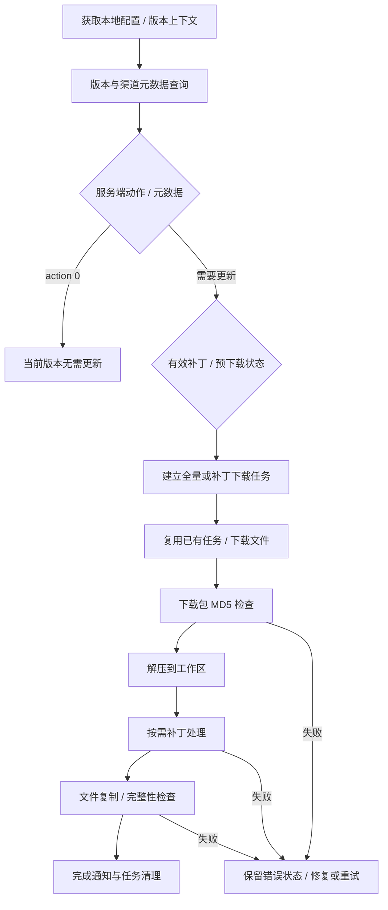

# 官方启动器如何更新《明日方舟：终末地》

调查日期：2026-10-16。本报告基于本机官方 1.6.0.1604 启动器的 REA / IDA 只读反编译、四组官方版本 API 查询，以及少量本地更新清单的只读结构检查。

## 结论

游戏本体更新由版本目录里的 **Games.exe** 组织，并不是根目录 Launcher.exe 单独下载一个 Endfield.exe 覆盖掉。可以确认的链路是：读取游戏配置和版本上下文 → 查询游戏版本元数据 → 按全量包、补丁、预下载等情况建立任务 → 下载与校验 → 解压 → 按需运行文件补丁流程 → 复制 / 检查文件 → 更新任务状态并清理缓存。

已经恢复了可供独立 Rust 更新器参考的元数据接口、主要响应字段、下载任务调度和补丁进程边界。**尚未完整恢复 Patch.exe 的补丁算法、本地配置编码、版本记录的最终持久化规则，以及断电后的原子提交 / 回滚保证，因此不能宣称已得到可直接替代官方更新器的完整实现。**

本轮没有运行 Launcher.exe、Games.exe、Patch.exe 或游戏，没有下载任何游戏安装包、分卷或补丁，没有向官方安装目录写入文件，没有 hook 游戏，也没有休眠。网络请求只获取版本 JSON；返回 URL 的临时 `auth_key` 值在保存前已剔除。没有读取实际账户令牌。

## 1. 分清三条流程

| 流程 | 主体与接口 | 包 / 后处理 | 与目前 Rust 工具的关系 |
| --- | --- | --- | --- |
| 引导启动器 | 根 Launcher.exe | 解析版本目录、深链接并调度后续启动；本轮复核入口 `0x14003C410` | Rust 启动工具不需要运行这段入口 |
| 官方启动器自身更新 | `/api/launcher/get_latest`，也可被批量请求包装 | 启动器发布 ZIP、`Updater.exe`、应用更新配置 | 目前 Rust 的 Games.exe 检查 / 缓存下载属于这一条 |
| 《终末地》游戏本体更新 | `/api/game/get_latest`；正常组合查询通过 `/api/proxy/batch_proxy` | `pkg` 全量分卷、可选 `patch` / `pre_patch`、下载 SDK、解压 / 补丁 / 文件检查 | 本报告研究对象；目前 Rust 工具尚未实现它 |

启动器自己的 `appcode` 是 `abYeZZ16BPluCFyT`；本机 CN《终末地》的游戏 `appcode` 是 `6LL0KJuqHBVz33WK`。两者不能互换。`target_app=EndField` 属于启动器发布选择上下文，不等同于游戏的 appcode。

本轮在 Games.exe 找到的 `file_list` 字面量，交叉引用落到 `CLibAppUpdateAssistImpl::_CreateUpdateConfigFile`（`0x14029F760`），内容包括 `main_exe_name`、`updater_mutex_name`、`local_ver`、`new_ver` 等。它是**启动器应用更新配置**，不能据此把 `file_list` 当作游戏文件清单格式。

## 2. 目标身份与证据范围

| 文件 | SHA-256 | 本轮覆盖 |
| --- | --- | --- |
| `D:\yj\Hypergryph Launcher\Launcher.exe` | `0e4dacaaa7022c3b93856f762cae4f7e074ade45f7d096f1eb8f7cb9bc2de2b3` | REA / IDA 复核引导入口 |
| `D:\yj\Hypergryph Launcher\1.6.0\Games.exe` | `dab34efc96bf08113fe25a642e38cea05221ae81e8aa31453d5b39add6e2bb55` | 本轮主要反编译对象 |
| `D:\yj\Hypergryph Launcher\1.6.0\Patch.exe` | `8c9f761d616b3e89387d41f87a1e558d67486335d8e2d0bc120137495c02fb00` | 只测量文件身份；未打开其反编译会话 |
| `D:\yj\Hypergryph Launcher\1.6.0\hgdownloadsdk.dll` | `9536e4b2cb98db26d29e9889e1350d990c6805a5c1e733a37cab806e80dac451` | 只测量身份；调用方边界来自 Games.exe |

下文地址均为上述 Games.exe 的 IDA VA，除非明确标注为 Launcher.exe。类 / 函数名主要依据嵌入的源码路径和日志字面量恢复；数据库中的自动模板名称有误配，不能直接当作可靠符号。伪代码不是原始源码，未解析的间接调用仍是未知。

Games.exe 的本轮完整 REA 证据：[`endfield-game-update-native-evidence.json`](endfield-game-update-native-evidence.json)，84 条记录。Launcher.exe 的独立会话导出：[`endfield-game-update-launcher-evidence.json`](endfield-game-update-launcher-evidence.json)，2 条记录。两个会话分别保存，避免混淆目标身份。

## 3. 更新查询如何发起

### 3.1 原生调用链

```text
CGame::DoQueryLatestGame                 0x1400D1080
  查询原因映射 / 状态检查                0x1400D8C70
    包装                                0x14023A410
      CLibGameAssistImpl::Query_ProtocolVer_LauncherVer_GameVer
                                        0x140251CD0
        包装                            0x14026AB30
          CGameVersion::Query_ProtocolVer_LauncherVer_GameVer
                                        0x14026E750
            CLauncherHttpClient::Post_ProtocolVer_LauncherVer_GameVer_Req
                                        0x1402EC6C0
```

`0x1400D1080` 根据查询原因选择内部动作，并保留继续下载、重试和原因文本。`0x14026E750` 在对象 `+344` 使用处理中标志防止重复查询，收集协议版本、启动器版本、语言、主 appcode / 渠道、游戏版本 / appcode / 渠道、磁盘类型等上下文，再进入 HTTP 层。这里不是单纯比较两个 EXE 的 FileVersion。

### 3.2 正常组合请求

`0x1402EC6C0` 可把协议、启动器、游戏等请求放进同一 JSON：

```json
{
  "seq": "<本次请求标识>",
  "proxy_reqs": [
    {
      "kind": "get_latest_game",
      "get_latest_game_req": {
        "appcode": "6LL0KJuqHBVz33WK",
        "channel": "1",
        "sub_channel": "1",
        "version": "<本地游戏版本>",
        "launcher_appcode": "abYeZZ16BPluCFyT",
        "launcher_sub_channel": "1",
        "disk_type": "1",
        "patch_encrypt": true
      }
    }
  ]
}
```

目标为 `https://launcher.hypergryph.com/api/proxy/batch_proxy`。同一构造函数还支持 `get_protocol`、`get_latest_launcher`、`batch_get_latest_game` 和 `batch_get_launcher_action`。`seq`、是否包含各项、磁盘标志的具体值由上层决定；示例只展示已恢复的游戏请求分支，不能视为所有渠道的固定完整报文。

代码存在设备标识、用户令牌请求头的设置位置；本轮未读取它们的真实值。下节公共直接接口的查询没有使用账户凭据，不能据此断言所有批量接口、付费 / 其他渠道分支也都不需要认证。

接口映射函数 `0x1402E6700` 明确区分：类型 `1` → `/api/game/get_latest`，类型 `2` → `/api/launcher/get_latest`，类型 `6 / 27` → `/api/proxy/batch_proxy`。这与网页公告使用的 `/api/proxy/web/batch_proxy` 也不同。

## 4. 官方 API 实际返回了什么

本轮另外对公共直接接口做了受控 GET 查询，四组结果均 HTTP 200：

```text
https://launcher.hypergryph.com/api/game/get_latest
  ?appcode=6LL0KJuqHBVz33WK
  &channel=1
  &sub_channel=1
  &version=<待查询版本>
  &launcher_appcode=abYeZZ16BPluCFyT
  &launcher_sub_channel=1
  &disk_type=1
  &patch_encrypt=true
```

| 请求 version | 返回 version | action | 全量分卷数 | patch | pre_patch |
| --- | --- | --- | --- | --- | --- |
| `1.6.3` | `1.6.3` | `0` | 0 | null | null |
| `0.0.0` | `1.6.3` | `1` | 59 | null | null |
| `1.6.2` | `1.6.3` | `1` | 59 | null | null |
| `1.6.0` | `1.6.3` | `1` | 59 | null | null |

这是 2026-10-16 13:26 左右本次查询的服务端状态，不是永久版本信息。源码分支支持差分，但**这四组响应没有提供差分补丁**；不能把 `1.6.2 → 1.6.3` 自动解释成当前可用的小补丁。

全量响应关键结构：

```json
{
  "action": 1,
  "version": "1.6.3",
  "request_version": "0.0.0",
  "pkg": {
    "packs": [
      {
        "url": "https://beyond.hycdn.cn/.../packs/Beyond_Release_....zip.001?<临时签名>",
        "md5": "<该分卷的服务端 MD5>",
        "package_size": "1073741824"
      }
    ],
    "total_size": "130918430460",
    "file_path": "https://beyond.hycdn.cn/.../files",
    "game_files_md5": "fdfabe3ca5923c76e9f12e04d7e5eb32"
  },
  "patch": null,
  "pre_patch": null,
  "state": 0,
  "launcher_action": 0,
  "client_version": "1.6.3"
}
```

实际分卷为 `.zip.001` 到 `.zip.059`。前 58 卷各 1,073,741,824 字节，最后一卷 99,895,828 字节；各卷声明大小之和为 **62,376,921,620 字节，约 58.09 GiB**。`pkg.total_size` 为 **130,918,430,460 字节，约 121.93 GiB**；后者是元数据中的总大小字段，不能直接当成更新峰值所需的可用磁盘空间。临时下载 / 解压 / 旧文件可能另占空间，具体规则取决于任务分支。

分卷顺序、逐卷 MD5 和大小已经可从元数据读取。文件名说明它们是 ZIP 分卷发布；本轮没有下载分卷验证压缩容器内部，也没有把它们当成每卷独立可解压的普通 ZIP。

可复现脚本：[`probe-endfield-game-metadata.ps1`](probe-endfield-game-metadata.ps1)。结果：[`game-update-live-metadata.json`](game-update-live-metadata.json)。保存结果将签名 URL 改写成 `{url_without_query, query_keys}`，因此这是脱敏后的研究证据，不能直接送入下载器使用。

## 5. JSON 解析与可选补丁结构

`CLastestGameInfo::FillData`（`0x1402E5270`）调用 `CLibNetworkUtils::ParseLatestGameJson`（`0x1402F1E80`）。后者约 87 KB 伪代码，读取如下字段：

| 范围 | 已观察到的字段 | 说明 |
| --- | --- | --- |
| 根 | `action`、`version`、`client_version`、`request_version`、可选 `launcher_action` | 服务端动作与版本上下文 |
| `pkg` | `packs`、`total_size`、`file_path`、`game_files_md5` | 全量 / 修复资源上下文 |
| 分卷条目 | `url`、`md5`、`package_size` | `_GetPackInfoListFunc`，`0x1402F04E0`；支持列表结构 |
| `patch` | `url`、`md5`、`package_size`、`total_size`，读取 `cd_key`；可选 `patches` | 普通补丁信息，代码保留旧单包和多包路径 |
| `patch` 的 v2 信息 | `v2_patch_info_url`、`v2_patch_info_md5`、`v2_patch_info_size` | 补丁说明文件的 URL / 校验 / 大小 |
| v2 验证 | `v2_verify_files_url`、`v2_verify_files_md5`、`v2_verify_files_size`、`v2_verify_category_list` | 按文件 / 类别验证上下文；列表处理中出现 `move`、`patch` |
| `pre_patch` | `package_size`、`total_size`、`patches`、`version`、`client_version` | 预下载信息，与当前安装任务分开 |

这张表来自解析代码，不表示所有字段在每次真实响应中都非空。`cd_key` 是字段名观察，本轮没有读取任何真实值，也没有据此确定加密算法。`patch_encrypt=true` 是客户端请求字段，不能单凭它就断言补丁采用某种具体密码算法。

版本判断：`0x1402E5510` 判断已保存的 `action == 0`；`0x1402E5580` 用 `action != -1` 表示该处信息有效。另有 `action == 1` 后检查补丁相关结构有效性的辅助函数 `0x1402E5520`。因此 **action=1 表示更新动作，不意味着一定有可用差分包**，本轮全量响应就是例子。

## 6. 下载、恢复与校验



图中后半部分是已恢复回调和任务分支的归纳，并非本轮观察到的真实更新运行轨迹；不是每一种下载都必须经过同一组动作。

`CGame::_TryDoUpdateGame`（`0x1400DCB80`，既有证据）检查游戏信息、是否最新、是否已有任务及界面对话框占用，选择新下载或恢复下载。新追踪的下层链：

```text
包装                        0x140239E50
CLibGameAssistImpl::DownloadGame 0x140249FF0
CGameAssist::DownloadGame    0x14025C7F0
CGameDownload::DownloadGame  0x140272FE0
CHgDownloadBase::Download    0x1402B21C0
CDownloadSDKInitAssist::Init 0x1402AE370
```

`0x140272FE0` 的文件类型 switch 为 1 / 2 / 3：其中 2 读取当前补丁上下文，3 读取普通全量信息，1 读取预下载上下文；这个解释由数据来源和上层调用共同推导。函数把版本、包条目、下载目录、解压工作目录和修复 / 继续下载标志整理后交给下载层，不只是把 URL 列表逐个下载。

该函数明确处理“包校验中断”“解压中断”“完整性检查中断”“复用预下载 ZIP”“修复下载 ZIP”“请求继续下载”“是否需要补丁文件”等上下文，并遍历已有包 / 文件状态，决定哪些需要继续处理。已找到恢复分支，但没有恢复下载 SDK 的断点文件格式、HTTP Range 策略或所有重试时序。

下载 SDK 初始化配置包含 `downloadPath` 和 `taskSize:100`。`hgdownloadsdk_2` 是该处导入调用；初始化接受返回值 0 / -301，并由 100 ms 定时器检查。新复核 `0x1402AE9D0` 显示，`hgdownloadsdk_10()` 返回 100 时进入初始化完成分支。这里的 100 不能解释为“100 个下载线程”。`0x1402B06D0` 调用 `hgdownloadsdk_9()` 清理任务；不要仅凭导出序号猜成添加文件或恢复下载 API。

校验层至少包括两种不同对象：

1. 下载分卷自身：元数据逐卷提供 MD5 / 大小，Games.exe 有 `CCheckGameDownloadZip` 路径。其损坏状态会影响是否重下、重新检查和解压。
2. 安装文件 / 验证清单：`CCheckGameComplete::_DoCheckGameFilesMd5`（`0x140280500`）加载文件 MD5 信息，对清单自身的 MD5 与服务器值作比较，然后调度文件检查；缺少信息会失败。不能把“校验包 MD5”当成“已校验安装后的每一个文件”。

## 7. 解压、Patch 进程与完成回调

### 解压与补丁分工

`CGameAssist::_DoDecompress`（`0x140265770`）从任务元数据准备下载文件列表、检查文件存在、拒绝空列表，进入解压状态并设置解压参数。`OnDecompressFinished`（`0x14025FA10`）处理正常 / 错误 / 强制中断原因；正常且适用时进入 `CGameAssist::_DoPatch`（`0x140266240`）。

`_DoPatch` 读取当前任务的补丁 URL、MD5、大小等，设置状态值 12，通过补丁对象的间接接口调度；这一步不是简单重命名分卷文件。某些任务可走不需要实际差分的分支，不能声称每次全量安装都对全部文件做差分。

### 补丁说明文件检查

`CPatchGameFile::DoPatchPrevCheck`（`0x140285D80`）检查补丁 JSON 是否存在、大小是否符合预期、MD5 是否匹配。通过后继续 patch；失败则通知重新下载 JSON。`OnTimerRetryDownloadJson`（`0x140287600`）停止当前定时器、查找任务信息，再安排名为 `patch.json` 的文件下载，创建失败有明确错误分支。

`0x140278DC0` 还构造与 `package_files`、`delete_files.txt`、`patch.json` 有关的文件 / 路径列表。这证明存在这些辅助资源的处理，但这一个函数不足以恢复删除列表的完整语义、提交顺序或所有路径规则。

### 独立补丁进程

`CPatchController::LaunchPatchProcess`（`0x140293510`）检查是否有前次补丁进程仍运行，准备新的进程对象与启动参数，参数构造出现 `--log`、`--pid`、`--vertype`、`--userid`。本轮只分析了参数名，没有读取实际用户标识。

这一控制器与本机 `Patch.exe`、补丁消息处理类、`hg_patch_file_launcher_` / `hg_patch_file_hgp_` IPC 名称种子共同指向独立补丁工作进程。**直接从当前伪代码还未完全还原可执行文件路径拼接和完整 IPC 帧格式**；独立进程角色可信，但不提供一个声称已验证的 Patch.exe 手工命令。`0x140295DB0` 为补丁任务序列化边界，涉及 `patch_files_dir_path` 等全局键指针；其完整消息协议仍需额外恢复。

Patch.exe 自身本轮没有反编译。因此以下均未知：实际差分算法（不能默认是 bsdiff / xdelta / HDiffPatch）、补丁加密 / 解密细节、原文件校验策略、原子替换粒度、补丁执行顺序、跨文件事务与崩溃回滚保证。仅看到 `failed_patch_list`、错误回调或 broken 状态，不能当作已证明完整回滚。

### 完成与版本持久化的边界

`CGameAssist::OnGameFileCopyFinish`（`0x1402625B0`）读取复制 / 完整性检查上下文，发送完成信息、进入状态 17，再按分支安排后续完整性检查、清理下载任务 / 解压数据，最后回到空闲相关状态。复制成功并不代表所有分支都立即完成，某些分支继续检查文件。

已找到 `CGameVersion` 的本地文件处理辅助链 `0x14026A5B0 → 0x14026CCE0 → 0x14026F960`；后者包括路径准备、文件操作成功判定和通知。但**不能仅凭这些未命名辅助函数就宣布已经找到“最终写入新游戏版本”的唯一提交点**。本地版本何时写入哪个编码文件 / 数据表，以及失败时如何恢复，仍是未恢复部分。也不能给出“手工把 config.ini 改版本即可升级”的建议。

## 8. 本机更新辅助文件的限定观察

只读结构记录：[`game-update-local-structure.json`](game-update-local-structure.json)。未修改、尝试解密或执行这些文件。

| 本地文件 | 大小 | 观察 |
| --- | --- | --- |
| `config.ini` | 256 字节 | 文件开头不是明文 INI；只筛选版本 / 渠道白名单键没有结果，未恢复编码格式 |
| `game_files` | 222,432 字节 | MD5 为 `fdfabe3ca5923c76e9f12e04d7e5eb32`，与本轮 1.6.3 API 的 `pkg.game_files_md5` **完全一致**；内容不是直接可读 JSON |
| `verify_files` | 70,864 字节 | 非直接明文 JSON，未恢复编码 |
| `verify_files.json` | 70,860 字节 | 明文 JSON，根键为 `move`、`patch`；分别 297 / 224 项，条目键均为 `path`、`md5`、`size` |

`game_files` 的 MD5 匹配把“服务器清单校验值”与“本机清单文件”直接关联起来，这是本轮新增的交叉验证。`verify_files.json` 的结构也与解析代码中的 move / patch 类别一致。结构一致和内容身份匹配仍不等于已经证明该文件在每次启动或每次更新都被实际读取。

此前对 `eld_Games.db` / `eld_Updater.db` 的普通 SQLite 解析失败，见既有报告；本轮没有读取账户表或尝试绕过数据库编码。不要因扩展名 `.db` 就实现普通 SQLite 写入，更不要依据文件名猜测版本存储 schema。

## 9. 证据索引

每项均可在上述 Games / Launcher REA 导出中按 Evidence ID 找到；附近单独 JSON 方便聚焦复核。

| 问题 / 函数 | REA Evidence ID | 聚焦文件 |
| --- | --- | --- |
| Launcher 引导入口 `0x14003C410` | `ev_97da74c0addfebfc339540aef877444ef553bfbc5790359b7406119c55c7c3ea` | `game-update-launcher-bootstrap.json` |
| 查询入口 `0x1400D1080` | `ev_bac4746b156ee1a98085ed2e425e085b1eba8a2c2abc266e163e20354cd5461a` | `game-update-query-entry.json` |
| 组合查询 `0x14026E750` | `ev_9b9858ee085bb4e346df108aa56d697cd1c8d6579cd7d98cba1ce916b2cf6770` | `game-update-query-network.json` |
| HTTP 组合请求构造 `0x1402EC6C0`（既有） | `ev_19621e6b97be29507641198094fa66723d8858aaac55b4396daa87a5a2bed9df` | `acq-batch-request.json` |
| API 路由 `0x1402E6700` | `ev_3392bc43cc1a59f0ef84072edc435346b6d80099aa2a04b49c26dee6e2d4548e` | `game-update-request-game.json` |
| 最新游戏 JSON `0x1402F1E80` | `ev_123b47b19a95f809479bc2a80134ce0ca842678c96a025136fdf4df755cf6684` | `game-update-latest-game-parser.json` |
| 分卷解析 `0x1402F04E0` | `ev_a062debf09ff0472bf50410f2bd4afa52621a1d5ecf42a601ea302488e1d6ac5` | `game-update-parse-pack.json` |
| 下载分派 `0x140249FF0` | `ev_8cea883e6eed4f7758698de9c70cc042c54d237dd8659eb5ca33ac39ed277653` | `game-update-download-dispatch.json` |
| 游戏下载任务 `0x140272FE0` | `ev_7fbe48ff28a865fd50e42c5e554480d2b98525365b2615a327a2e149a4c42b3d` | `game-update-task-create.json` |
| 下载底层入口 `0x1402B21C0` | `ev_b6af2c5cf89c7b8bf0401467480ecd3751039943ace2d4881cb2d9308e97b8a6` | `game-update-sdk-create-task.json` |
| 解压入口 `0x140265770` | `ev_b0d77f0079d92a0032eef509a9b99a6c95aa695825549d8da36173a5c0d8fa98` | `game-update-decompress.json` |
| 补丁前检查 `0x140285D80` | `ev_40608ab2db8ee4281abbdb650b34684a8327711cf62b41e806cfad616240bbf1` | `game-update-patch-precheck.json` |
| 补丁进程边界 `0x140293510` | `ev_a0450fdf32eff76b7c340081eaf7b47d002bc0e00217b9ba37ccdc98b56ded7d` | `game-update-launch-patch.json` |
| 文件 MD5 检查 `0x140280500` | `ev_b245ee7d0239f3097c30ace8ae900c336cd5cb892f8a96cda80dcb5b1a3e69f8` | `game-update-config-check.json` |
| 复制结束调度 `0x1402625B0` | `ev_653e755be19ac78cf041c0edaa6d77920f746eb63350c993cd8788b64cb3db1a` | `game-update-copy-finish.json` |

HTTP 构造引用的是工作区既有证据文件；其原始记录不属于本轮重新生成的 Games 会话。实时 API JSON、本地文件结构是独立只读观察，不伪造 REA Evidence ID。

## 10. 复现与后续实现边界

1. 校验目标 SHA-256；用 REA `open_binary` 选择 Games.exe 和 IDA。不要直接打开安装目录内分析数据库，也不执行官方程序。
2. 从 `0x14026E750` 跟到 `0x1402EC6C0`，核对游戏与启动器各自 appcode 的来源；从 `0x1402E6700` 核对 API 类型映射。
3. 读取 `0x1402F1E80` 与 `0x1402F04E0`，恢复 DTO，保留空值、可选字段和十进制字符串大小，避免按旧单包响应写死。
4. 可执行本报告的元数据脚本，仅得到 JSON；不跟随分卷 URL，不执行安装。其保存结果会去掉临时签名值。
5. 在工作区自造文件 / 包上实现下载计划、校验、取消和重试测试。下一阶段优先恢复 `game_files` 的编码，以及 `v2_patch_info` / `verify_files` 说明格式，再研究 Patch.exe；先不向现有安装目录提交。
6. 真正兼容更新还需要证明：版本提交、路径归一化 / 越界拒绝、分卷组合、补丁失败后的旧文件保护、取消 / 断电恢复。当前仅启动工具不应顺手添加未经验证的游戏目录写入。

| 研究问题 | 当前状态 |
| --- | --- |
| 游戏本体与启动器自更新是否不同 | 已回答，接口 / 调度 / 工具分工不同 |
| 当前游戏版本与全量下载元数据 | 已回答，有四组实际官方响应 |
| 当前旧版本请求是否返回差分 | 已回答本次四组范围：未返回；不外推全部历史版本 |
| 全量分卷结构、逐卷校验字段 | 已回答元数据层；未下载并打开实际分卷 |
| 补丁 / 预下载 / v2 验证字段 | 部分回答，来自原生解析代码，当前响应为空 |
| 下载 SDK 与恢复分支 | 部分回答，调用方与分支已定位；SDK 断点协议未恢复 |
| 补丁 JSON 校验及独立进程边界 | 已定位；完整 IPC / Patch 算法未恢复 |
| 本地版本持久化和原子回滚 | 未恢复，不承诺已可重写完整升级器 |

REA 的 IDA 适配器不提供完整函数体区间、可靠的 direct-call callers、typed references 和全部间接调用解析。本轮以聚焦 xref、地址解析和函数体复核建立链路；未把没有结果的 facet 当作不存在。完成后两个本轮打开的 REA 原生会话均已关闭，进程检查未发现 IDA 残留。
