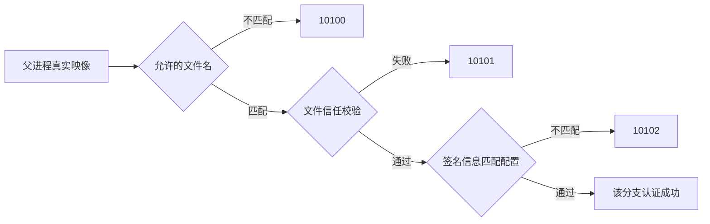
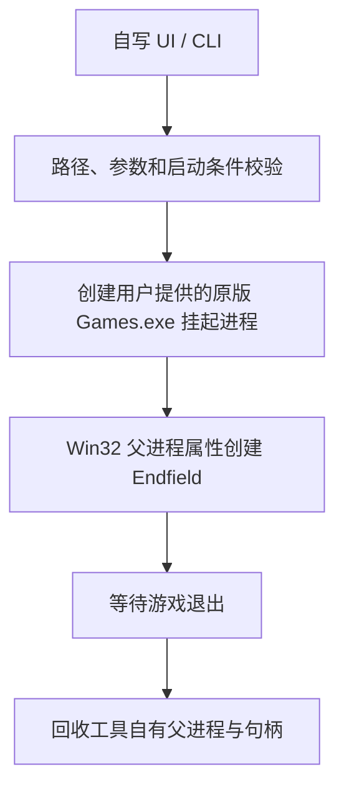

# Games.exe 行为研究与开源替代可行性

日期：2026-10-16。目标：`D:\yj\Hypergryph Launcher\1.6.0\Games.exe`，SHA-256：`DAB34EFC96BF08113FE25A642E38CEA05221AE81E8AA31453D5B39ADD6E2BB55`。本轮通过 REA/IDA 和静态资源解析研究，未运行官方启动器或游戏、未修改安装目录、未 hook 游戏。本轮运行的是分析引擎；此前真实启动结果单独引用。

## 结论

**可以重写一个开源的启动工具，也可以逐步重写界面与管理功能；但现有证据不支持把自行编译的 Games.exe 当作原版的完整直接替换。** 当前主要障碍是游戏侧对父进程文件的信任与签名信息检查，不能靠复现启动器行为自动解决。

| 目标 | 当前判断 | 依据与边界 |
| --- | --- | --- |
| 启动已安装游戏，自写 Rust 逻辑，保留一个原版 Games.exe | 已有实现，已实机通过 | 原版父映像在工作区创建为挂起进程，其主线程不恢复；独立目录测试得到用户确认 |
| 自写游戏列表、设置、启动按钮与进度界面 | 可设计实现，尚未制作新界面 | 已恢复一部分 WebChannel 契约；新实现可使用自有 UI 和数据模型 |
| 重写下载、校验、安装、差分更新、修复 | 功能范围已确认，协议恢复不完整 | 找到原生调度与下载 SDK 初始化边界；尚无完整清单、补丁、回滚规范 |
| 完全不携带任何官方 EXE，自行编译 Games.exe 直接作为游戏父进程 | 当前没有验证可行的实现 | 普通 Rust 父进程已被拒绝；文件名通过后还有信任和签名信息检查，完整配置尚未恢复 |

这里的“当前没有验证可行”不是对所有版本、所有认证配置或其他启动路径的不可能性证明。我们没有测试修改系统信任策略，也没有取得官方签名授权；这些均不作为本方案的前提。

## 1. Games.exe 实际承担哪些行为

### 入口与应用初始化

WinMain `0x1403388A0` 使用 GetCommandLineW / CommandLineToArgvW 获取参数，转换后调用 `0x140137990`。后者含 main.cpp 日志，执行深链接注册、工作目录设置、初始化以及 QApplication::exec。

- WinMain 证据：`ev_bbbe5f81faceee749ab54ca5d42d38ce69b1ac52329ef19f4a5d9952010c70a8`，见 `games-entry-code.json`。
- main 证据：`ev_cd69a516599ed721afa3cb4ab61fc464168ec554f8ca01f69568013eb97badd0`，见 `games-main-code.json`。
- `CHgApp::Init`，`0x1400FB500`：调用管理器初始化，包含系统托盘、主窗口创建及失败处理；证据 `ev_3e94e6cc9a676991ebe71a24bb7d8a15f5fcaba630c586af2bc9d2fdcfad23c9`。
- `0x1400FF330` 对应日志 `CHgUpdateMgr::IsSameUpdateProcessExist`，检查更新进程相关互斥状态；证据 `ev_9be46b19e4bda8b9901d22176979ce1fe3acec600870cfc57f345697abc980ae`。这不足以宣称已恢复应用全部单实例/IPC 协议。

以上是静态控制流，不表示本轮执行过深链接注册或任何配置写入。`0x140073640` 只是已检查到的静态对象访问器，不能把它误判为进程单实例检测。

### 界面和按钮状态

Games.exe 配套 Qt WebEngine/WebChannel 界面。网页绑定 `HGJsBridge`：网页调用 `SendMsgToNative(event, JSON字符串)`，原生通过 `SendMsgToWeb` 回传事件。

主按钮发 `click_main_btn({uuid})`，**不是每次都表示启动**。资源中的状态包括下载、暂停、排队、校验、安装、启动、更新、游戏运行中、停服以及需登录等。新实现必须将按钮意图交给状态机，再决定执行哪个动作。

已整理的其他契约包括：游戏列表、切换游戏、渲染设置、快捷方式、资源完整性检查、缓存清理、预下载及进度通知。字段、字符偏移、资源哈希和限制见 [资源侧报告](games-resources.md)。这些是前端调用结构，尚未逐项证明原生处理器的完整运行语义。

REA JS summary：`ev_d0868cc1452cfa07eb0b4c60d0ff2d228a1f595742c6814fd8fc662cc982e6f9`；主文件解析成功，但语义图触及节点上限，不能声称前端全部关系已恢复。

### 启动已安装游戏

已确认的原生链：

```text
CGame::_StartGame               0x1400DC290
  CGame::_DoStartGame           0x1400D8DC0
    CGlobalAssist::StartGame    0x1400CA2E0
      CLibGameAssistImpl        0x1402522F0
        包装函数               0x140264350
          CGameStartUp::StartGame 0x140279FD0
            CGameStartUp::run   0x14027AED0
              CreateProcessW   0x14027B371
```

`_StartGame` 中有 Epic 刷新令牌相关分支，不能把它当成所有渠道启动的共同要求。之前本机 CN 版本已经在不执行这条启动器链的情况下进入正常游戏画面。

最终 run 构造绝对游戏 EXE 路径、游戏目录 cwd、语言/子渠道以及可选渲染参数，创建进程后等待其退出。新一轮复核证据为 `ev_3dc745e94e032fce26d83b18183ff1e9944175338ba5b0c8c8d08af5bb30f442`，见 `games-game-start-code.json`；原有调用链证据保留在 [启动链报告](reverse-engineering.md) 和 `../rea-evidence.json`。

本机历史官方参数：

```text
"...\Endfield.exe" -launcher_lang=zh-cn -launcher_sub_channel=1
```

### 版本查询、修复与更新

| 功能 | 地址及静态观察 | REA Evidence |
| --- | --- | --- |
| `CGame::DoQueryLatestGame` | `0x1400D1080`；按查询原因映射内部动作，检查状态后写入原因/继续下载/重试等字段 | `ev_a3809734121ce33def8c389064a5881039ec1812c00a7fc17d00da8f28198ab6` |
| `CGame::DoGameCompleteCheck` | `0x1400D0600`；存在更新中拒绝、修复确认、无效本地文件分支以及后续调度 | `ev_c1aa4371086c995ae7b3b82475959cd1a10cf4c2dea96c35d06424448aab54ff` |
| `CGame::_TryDoUpdateGame` | `0x1400DCB80`；检查对话框占用、游戏信息有效性、是否最新，分流 DownloadGame / ResumeDownload | `ev_7a7bf1678114426252321f1258f748b9de11f452dc49289aa1c5792681cadb6a` |
| `CHgUpdateMgr::_DoHgUpdate` | `0x140102650`；普通/静默更新、用户确认、等待任务、准备 Updater.exe，再调用 StartUpdate 相关包装层 | `ev_6e5d10db078a5fcb4415550ceb5657a504d02fa8479a59dcc5545b67348673e9` |

该表只说明已经检查的函数行为，不等于完整的状态转换和网络协议恢复。`0x1400D1080` 的数据库标签被识别为不相符的 STL 模板名称；上表功能名根据函数体中的 `CGame::DoQueryLatestGame` 日志及控制流解释，不直接采信错误标签。

### 下载 SDK 的实际调用

`CDownloadSDKInitAssist::Init`，`0x1402AE370`，构造含如下字段的配置，再于 `0x1402AE50D` 调用导入 thunk `hgdownloadsdk_2`：

```json
{"downloadPath":"<调用方提供的下载目录>","taskSize":100}
```

函数将返回值 0 或 -301 视为该处初始化接受结果，并在成功路径准备 100 ms 的 Qt 定时器检查。`taskSize` 的完整业务含义未恢复，不能仅凭名称把 100 解释为下载线程数。

证据：`ev_e3dc36fd68a3758b765b5eea317d4d17e3df721158efdb3651007cd6d671f307`，见 `games-download-sdk-code.json`；入口 thunk 引用证据 `ev_65227cd5622fa835f9e26a79aacda6a4e03f9a15840ef83f5a27a4c02c7a94f1`。反编译器对字符/宽字符函数有类型推断，不能把伪代码格式串直接复制成可编译调用。

这确认下载行为不是单凭目录中存在 hgdownloadsdk.dll 猜测出来的。要写独立下载器，仍需恢复其上层任务输入、清单与输出文件规则；也不能把调用官方 DLL 的包装器称为完整的下载实现重写。

## 2. 为什么复刻行为不等于通过启动认证

游戏内的检查链是：`U8SDK.dll -> OneChannelLC.dll`。已恢复的分支查询父 PID，再查询其真实映像路径，检查文件名、文件信任及签名信息。



核心证据：`ev_067bce76b3507c6fdbdfea36aa71eb7414cf56957eb72605d42d60926e3ecf85`，详细调用链见 [父进程认证报告](parent-check.md)。文件信任辅助函数 `0x180013AA0`：`ev_1a2f1b7d61e7ead28e1de7c2bf033fb419b700ec04a2172b526dddc34b281c50`；签名信息获取 `0x1800140C0`：`ev_0baaeb00d8e1a03ae504a37c4975e8f6d6b8200e24b6b7eac8d245e60bfaa6bd`。

本轮只读签名观察显示，原版 Games.exe 的 Authenticode 状态为 Valid，签发对象为 Shanghai Hypergryph Network Technology Co., Ltd.；当前 Rust EXE 为 NotSigned。原始记录见 `games-signature-observation.json`。证书指纹只是本机文件身份记录，**没有证据证明游戏按这个指纹做精确固定**。

微软对 [WinVerifyTrust](https://learn.microsoft.com/en-us/windows/win32/api/wintrust/nf-wintrust-winverifytrust) 的说明也区分了文件发布者信任与签名后代码完整性。由此可得：改文件名、复现 CreateProcessW、照抄命令行、复制文件版本信息，都不会自动赋予新程序官方签名；个人签名也不能据此证明满足游戏配置。

完整允许配置和签名信息字段尚未恢复；不应把结论夸大为“只有一个确切证书/哈希可用”，也不能把“持有有效个人代码签名证书”当成已验证解决方法。此前普通 Rust 父进程实际失败，原版签名父映像实际成功，分别是当前拒绝和通过的运行证据。

## 3. 可落实的开源架构

对于目前“只启动已安装 Endfield”的需求，可沿用现有 Rust 核心，将官方文件作为用户自行提供的外部依赖：



自写部分包括参数校验、UTF-16 命令行、Win32 FFI、父进程属性、生命周期管理、日志与界面。原版 Games.exe 只提供已有签名映像身份，其主线程不执行。完整流程与现有使用命令见 [实现文档](../IMPLEMENTATION.zh-CN.md) 和 [便携入口](../portable/README.md)。

开源仓库应把自写代码与外部官方文件明确分开，不把原版 Games.exe、Qt/网页资源、官方 DLL 或私人日志标为自行开源的代码；源码包不必附带这些二进制，由使用者选择本机文件。当前工作区便携测试目录中确实保存了原版 Games.exe，不能直接把整个目录等同于纯源码发布包。源代码的许可证尚需作者明确选择；本轮没有发布仓库或打包上传。

完整管理器可按以下边界设计，但这部分是实现建议，尚未实现和验收：

| 层 | 自有职责 | 当前状态 |
| --- | --- | --- |
| UI / CLI | 游戏路径、渲染设置、状态、错误与进度 | CLI 已有；新 GUI 未实现 |
| 应用服务 | 启动意图、版本查询、任务队列、取消/恢复 | 启动生命周期已有；其他待实现 |
| 启动后端 | 指定父进程、等待、清理 | 已实现并通过本机测试 |
| 元数据后端 | 校验清单来源、版本比较、路径安全 | 协议未恢复 |
| 下载/校验后端 | 工作区缓存、断点恢复、哈希和空间检查 | SDK 边界已定位，独立实现待研究 |
| 安装/补丁后端 | 暂存、差分、提交、回滚 | 未恢复；当前只读约束下不能向安装目录实测 |

不必兼容官方 UI 桥接的每个消息；自有 UI 可直接调用 Rust 服务层。也不必复刻启动器自更新、公告、营销内容和账户界面来完成最小启动目标。

## 4. 后续研究顺序和验收标准

1. **最小启动工具：已有结果。** 保留当前实现与进程探针，明确依赖原版签名父映像；便携入口固定显式 --parent，避免回到默认安装路径。
2. **配置独立：待实现。** 使用项目自己的配置保存路径和参数，避免写官方数据库；增加原版文件身份诊断，但先不把某一个证书指纹硬编码成通用规则。
3. **只读版本/清单研究：待恢复。** 从原生版本查询层继续追踪请求、响应字段和校验规则；前端公告接口不是包清单证据。必须拿到实际版本、包、哈希、路径及平台/渠道契约后才能实现可靠下载。
4. **工作区下载原型：待实现。** 先在独立测试目录验证取消/重试、断点恢复、损坏包拒绝、空间不足和目录越界处理，不向现有游戏安装目录提交文件。
5. **补丁/安装：待恢复。** 在工作区测试数据上验证差分和回滚；向真实安装目录写入超出当前约束，不能作为本次已完成事项。
6. **完全移除官方二进制：未解决。** 需要存在一个受支持、可满足认证的独立身份或替代入口。继续复刻 Games.exe 的下载、UI 或注册表行为，本身不会消除这项身份条件；没有证据时不继续承诺纯开源直接替换。

## 5. 证据质量、检查清单与未知

| 问题 | 状态 |
| --- | --- |
| 实际游戏创建边界在哪里 | 已回答，并有既有实际测试 |
| Games.exe 是否只是一个小进程启动包装 | 已回答：还包含应用、管理、修复和自更新逻辑 |
| UI / 原生交互能否参考重建 | 部分回答：主要事件与数据字段已整理，完整处理器语义未恢复 |
| 下载是否实际调用官方 SDK | 已回答：有明确调用点与初始化配置 |
| 独立签名父映像目录是否可启动 | 已有本机测试：用户确认成功；未卸载原启动器 |
| 自行编译程序能否完整替代签名父映像 | 当前无可行验收，认证配置仍有未知 |
| 下载清单、包/补丁格式与原子回滚是否完整恢复 | 未回答，不声称已实现 |
| 所有单实例、IPC、持久化协议是否恢复 | 未回答；仅定位更新进程相关检查 |

REA 的 IDA 适配器不提供完整函数体区间和可靠 direct-call callers；本轮 procedure_callers 返回 capability_unavailable 后，改用地址 xref、包含函数解析和函数体核对，不把 xref 自动当作直接调用。

search_strings 在此目标上会枚举巨大字符串表，上游截断导致 unreadable_output。保存的 `games-*-strings.json` 是失败结果与局部观察，只有前置身份核对，不能拿它宣称全量搜索。功能结论另由成功、前后身份核对的聚焦 xref/反编译支撑。静态反编译不是原始源码，也没有代替真实网络/更新运行测试。

本轮未制作纯开源替代 Games.exe、未重新运行游戏、未执行下载/修复/更新。现有 Rust 启动工具的通过结论来自此前用户确认；本轮增加的是功能边界和可行性研究。
